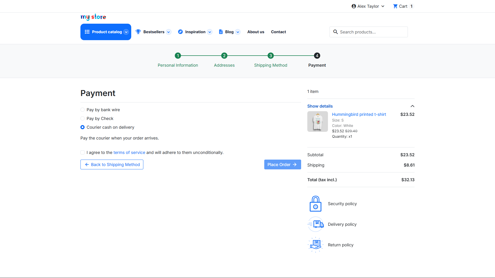
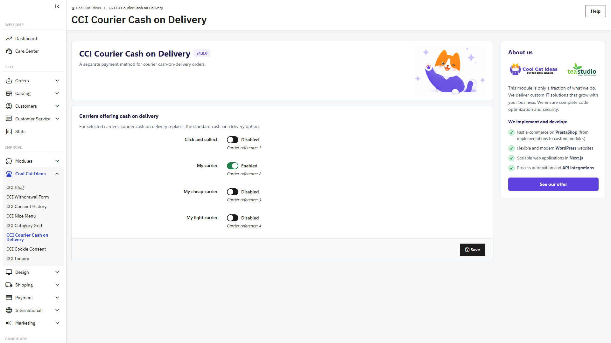

# CCI Courier Cash on Delivery

Set courier cash on delivery separately for each carrier you use. Customers see a clear courier payment name at checkout, and the order keeps the same payment name in the back office.

Download the module ZIP from the [Cool Cat Ideas product page](https://coolcatideas.com/products/cci-courier-cash-on-delivery/).

## Set it up

1. Download the current CCI Courier Cash on Delivery ZIP from the product page and install it in **Modules > Module Manager**.
2. Open **Cool Cat Ideas > CCI Courier Cash on Delivery**.
3. Turn on every carrier that should collect payment at the door.
4. Save the settings.
5. Place one test order with a selected carrier and one with an unselected carrier.

For selected carriers the customer sees **Courier cash on delivery**. Other delivery methods can still use PrestaShop's standard cash-on-delivery module.

If both payment choices appear for the same carrier, save this module's settings again and check the payment restrictions for both modules.

The module works without a license key. It changes new checkout choices and does not rename old orders.

## Choose existing carriers

Enable the carriers that should offer courier cash on delivery. The module uses the delivery methods already configured in your store. It does not create another carrier.

## Compatibility

- PrestaShop 8.0 through 9.2, including patch releases
- AFL-3.0

Release history is available in the [changelog](CHANGELOG.md).
